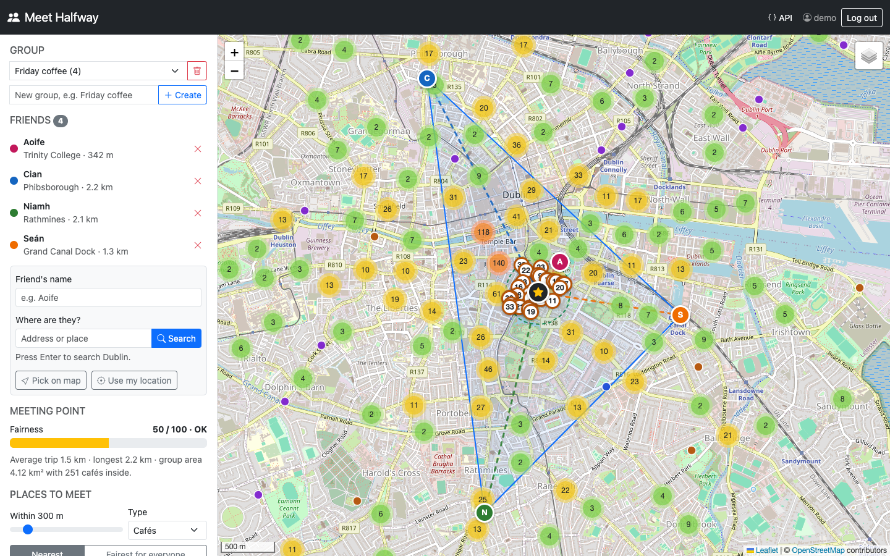
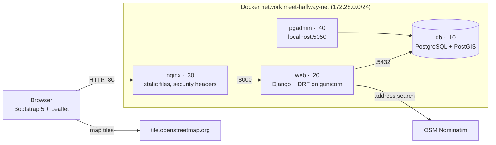
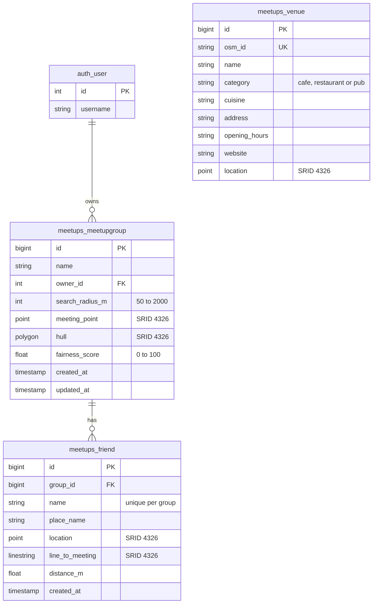
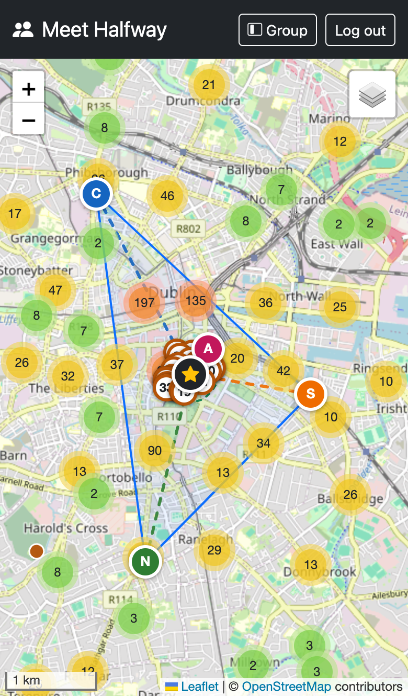
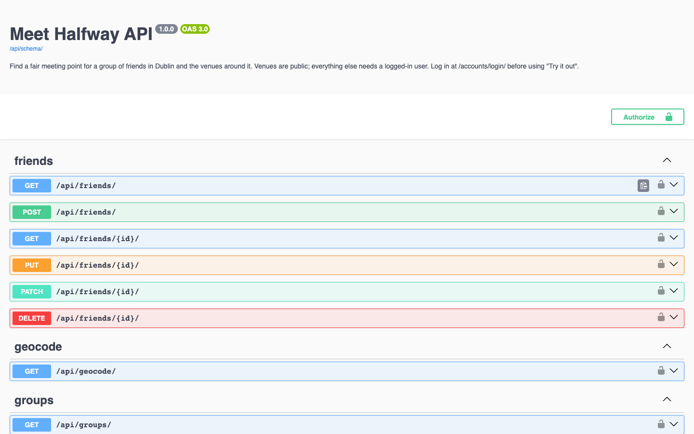

# Meet Halfway

Friends enter where they are and get a fair meeting point with cafés nearby.

A location-based web app built with Django, PostGIS and Leaflet. It finds the middle point of a
group of friends, shows each person's line to it and the area the group covers, lists cafés
within 300 m and gives a fairness score based on how evenly the distances are spread.



## Tech stack

- **Database:** PostgreSQL 16 + PostGIS 3.4, managed with pgAdmin 4
- **Back end:** Python 3.12, Django 5.2 (GeoDjango), Django REST framework, drf-spectacular
- **Front end:** Bootstrap 5.3, Leaflet 1.9.4, Leaflet.markercluster, OpenStreetMap
- **Deployment:** Docker Compose with Nginx and gunicorn on a private network

## Running it

Docker Desktop is required.

```bash
cp .env.example .env            # then set your own passwords and a long random DJANGO_SECRET_KEY
docker compose up --build -d
```

When the web container starts it applies the migrations, collects the static files and loads the
OpenStreetMap venues, so the app is ready after a minute (`docker compose ps` shows it as healthy).

```bash
docker compose exec web python manage.py seed_demo          # demo user: demo / meethalfway-demo
docker compose exec web python manage.py createsuperuser    # for the admin pages
```

- App: http://localhost (admin at `/admin/`, API docs at `/api/docs/`)
- pgAdmin: http://localhost:5050 (the PostGIS server is already registered: host `db`, port `5432`)

A secret key can be made with `python3 -c "import secrets; print(secrets.token_urlsafe(50))"`.
Stop everything with `docker compose down` (add `-v` to delete the database as well).

## Architecture



| Container | Image | Reachable from |
|---|---|---|
| `nginx` | nginx:1.27-alpine | http://localhost (port set by `HTTP_PORT`) |
| `web` | built from `Dockerfile` | the private network only |
| `db` | postgis/postgis:16-3.4 | the private network only |
| `pgadmin` | dpage/pgadmin4:9 | this computer only (127.0.0.1:5050) |

The code follows Django's MVC layout: models in `meetups/models.py`, the PostGIS queries in
`meetups/services/`, API controllers in `meetups/api.py`, page views in `meetups/views.py` and
`accounts/views.py`, and templates plus `static/js/` for the interface.

## Database



- **Points:** venues, friends and meeting points. **Lines:** each friend's line to the meeting point.
  **Polygons:** the group's convex hull (and the search circle, which is calculated, not stored).
- **Indexes:** a GiST index on every geometry column, a GiST index on `meetups_venue.location::geography`
  (migration `0002`) for distance searches, a B-tree index on `category` and a unique index on `osm_id`.
- The meeting point, hull, lines and distances are saved by PostGIS whenever a friend is added, moved
  or removed.

## Data

About 2,900 cafés, restaurants and pubs in Greater Dublin from OpenStreetMap, saved in
`data/dublin_venues.geojson`. Run `manage.py fetch_venues` to download them again.

## How the meeting point is found

All the spatial work is done in PostGIS, in `meetups/services/spatial.py`:

- **Meeting point:** `ST_Centroid(ST_Collect(...))` of the friends, calculated in Irish Transverse Mercator (EPSG:2157) so it is in metres
- **Lines and distances:** `ST_MakeLine` from each friend to the point and `ST_Length` on geography for metres
- **Group area:** `ST_ConvexHull` of the friends, `ST_Area` for its size and `ST_Contains` to count the venues inside
- **Venues nearby:** `ST_DWithin` on geography within the radius (300 m by default), nearest first, plus the `ST_Buffer` circle that was searched. If nothing is in range, the 5 nearest are found with the KNN operator `<->`
- **Fairness score:** `100 × (1 − standard deviation / mean distance)`, from 0 to 100: Fair (75+), OK (50+) or Unfair. The venues can also be ranked by the same score

Venue searches use a GiST index on `location::geography`. To see the query plan of the radius search:

```bash
docker compose exec web python manage.py explain_venue_search
```

Result for cafés within 300 m of the Spire (shortened):

```text
Limit  (actual time=63.211..63.277 rows=27 loops=1)
  ->  Sort  (Sort Key: st_distance(location::geography, ...), name)
        ->  Bitmap Heap Scan on meetups_venue v  (rows=27)
              Filter: st_dwithin((location)::geography, ..., 300)
              Rows Removed by Filter: 23
              ->  BitmapAnd
                    ->  Bitmap Index Scan on meetups_venue_location_geog_idx  (rows=111)
                          Index Cond: ((location)::geography && _st_expand(..., 300))
                    ->  Bitmap Index Scan on meetups_venue_category_df8070a2_like  (rows=1104)
                          Index Cond: ((category)::text = ANY ('{cafe}'::text[]))
```

The geography index finds the 111 venues in the box around the 300 m circle without reading the whole
table. PostgreSQL combines that with the category index, so only 50 cafés are checked with the exact
`ST_DWithin` distance, and 27 of them are within 300 m. The other ~2,900 venues are never read.

## User guide

1. **Register** (or log in as `demo` / `meethalfway-demo` after running `seed_demo`).
2. **Create a group** at the top of the sidebar, e.g. "Friday coffee".
3. **Add friends.** Type a name, then either type an address and press Enter and choose a result,
   press **Pick on map** and click where they are, or press **Use my location**.
4. With two or more friends the **star** shows the meeting point. Dashed lines show each friend's
   distance to it, the blue shape is the group's area and the green circle is the search area.
5. The **fairness** bar shows how evenly the travel is shared.
6. **Places to meet** lists venues around the star. Change the radius or the type, and sort by
   **Nearest** or **Fairest for everyone**. Click a place to zoom to it.
7. **Drag** a friend's marker to move them; everything is recalculated straight away. Remove a
   friend with × in the list or from their popup.
8. The layers button (top right of the map) shows or hides each layer. On a phone, the **Group**
   button opens the sidebar.



## API

Interactive docs: http://localhost/api/docs/. To try the endpoints that need a login, log in at
http://localhost/accounts/login/?next=/api/docs/ first.

- `GET /api/venues/` returns all venues as GeoJSON (public). Filters: `?in_bbox=minLon,minLat,maxLon,maxLat`, `?category=cafe`
- `GET/POST /api/groups/`, `GET/PATCH/DELETE /api/groups/{id}/` manage your own groups
- `GET/POST /api/friends/?group={id}`, `PATCH/DELETE /api/friends/{id}/` manage friends; the meeting point updates straight away
- `POST /api/groups/{id}/compute/` returns the meeting point, lines, group area, fairness score and venues nearby
- `GET /api/groups/{id}/venues/?radius=300&category=cafe` lists venues around the meeting point
- `GET /api/groups/{id}/fair-venues/` lists the same venues, fairest first
- `GET /api/geocode/?q=Heuston Station` searches for an address in Dublin (OpenStreetMap Nominatim)

Friend locations are GeoJSON points, e.g. `{"type": "Point", "coordinates": [-6.2546, 53.3438]}`, and must be in
Greater Dublin. A group needs 2 to 15 friends and a radius of 50 to 2000 m. Users only ever see their
own groups (anyone else's give 404). Requests are rate limited: 300 a minute for logged-in users, 120
for visitors and 30 address searches.



## Security

- All settings and passwords come from `.env`, which is never committed. `DEBUG` is off unless
  `.env` turns it on, and with `DEBUG` off the app refuses to start with the example secret key.
- Only Nginx is published to the network. The database and gunicorn are only reachable inside
  the Docker network, and pgAdmin only from this computer.
- gunicorn runs as an ordinary user, not root, and cannot change the app's code.
- Login and CSRF cookies are `HttpOnly` and `SameSite=Lax`. Logging out needs a POST.
- Nginx sends a Content-Security-Policy that only allows scripts, styles and fonts from the site and
  jsDelivr and map tiles from OpenStreetMap. Django adds `X-Frame-Options: DENY`, `nosniff`, a
  referrer policy and a cross-origin opener policy. Bootstrap and Leaflet from the CDN are checked
  with `integrity` hashes.
- The API checks every input (coordinates inside Greater Dublin, radius, friend limits, unique names)
  and the SQL uses parameters, never string formatting of user input.

## Tests

```bash
docker compose exec web pytest
```

The tests cover the spatial queries (centroid, 2 friends score 100, everyone at the same spot, radius
search, the Dublin Bay fallback, the fairness ranking), the API (logins, ownership, validation) and
the pages (register, log in and out).

## Known issues

- Distances are straight lines, not walking or public transport routes.
- Browsers only allow **Use my location** on HTTPS or `localhost`, so it doesn't work from a phone
  opening the site over Wi-Fi. Address search and **Pick on map** still work there.
- The group owner adds every friend; there is no invite link for friends to add themselves.
- Address search and map tiles need an internet connection. The public Nominatim service allows one
  search per second, so searches from many users at once may have to wait.
- The venue list is a snapshot of OpenStreetMap; run `fetch_venues` and `load_venues` to refresh it.
- `docker/pgadmin/servers.json` uses the database name and user from `.env.example`; change it if
  yours are different.

## Credits

- Map data, venues and address search © [OpenStreetMap](https://www.openstreetmap.org/copyright)
  contributors (ODbL), via the Overpass API and Nominatim
- [Leaflet](https://leafletjs.com) and [Leaflet.markercluster](https://github.com/Leaflet/Leaflet.markercluster)
- [Bootstrap](https://getbootstrap.com) and [Bootstrap Icons](https://icons.getbootstrap.com)
- [Django](https://www.djangoproject.com), [Django REST framework](https://www.django-rest-framework.org),
  [django-rest-framework-gis](https://github.com/openwisp/django-rest-framework-gis),
  [drf-spectacular](https://drf-spectacular.readthedocs.io) and [PostGIS](https://postgis.net)
